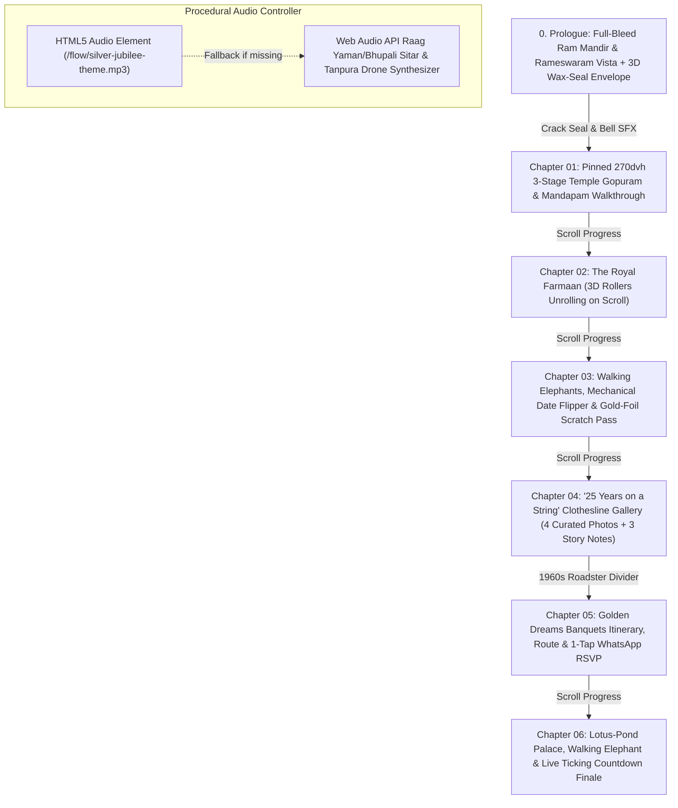

# Navneet & Ruby Goel — 25th Silver Jubilee Interactive 3D Web Experience

> [!IMPORTANT]
> **₹0 Infrastructure Guarantee**: This entire architectural stack is crafted to run completely free of charge on **Vercel Free Hobby Tier** paired with the host's existing **Google Drive (via OAuth2 Refresh Token)** for backend storage. The experience features full-bleed Ram Mandir & Rameswaram temple artwork, articulated walking elephants, and smooth GSAP-driven scrollytelling.

---

## Streamlined 6-Chapter Narrative Flow

---

## Detailed Chapter Implementation

### 0. Prologue — Full-Bleed Ram Mandir & Rameswaram Vista + 3D Wax-Seal Royal Envelope
- **File:** [PrologueEnvelope.tsx](file:///Users/piyushgoel/Downloads/Projects/25th/src/components/scenes/PrologueEnvelope.tsx)
- Replaced the blank dark screen with full-bleed `GrandTemplePanorama` (100vw $\times$ 100dvh) with rotating Surya halo, fluttering saffron Dhwaja, soaring birds, and temple steps with flickering diyas.
- Viewport-spanning scalloped marigold arch with 10 swinging brass bells (`HangingTempleBellsToran`).
- Walking caparisoned elephants and fanning peacocks in the foreground.
- 3D burgundy velvet envelope with metallic `#NR25` wax seal, golden bell cord, and 3-stage opening sequence into the temple sanctum.

### 1. Chapter 01 — 3-Stage Scroll-Unfold Temple Gopuram & Mandapam Walkthrough
- **File:** [Scene1PalaceHero.tsx](file:///Users/piyushgoel/Downloads/Projects/25th/src/components/scenes/Scene1PalaceHero.tsx)
- Pinned `270dvh` GSAP ScrollTrigger camera dolly through three stages:
  - **Stage 01 (01 • THE BEGINNING):** Grand Ram Mandir Gopuram vista with fluttering flag, swinging bells, and editorial typography.
  - **Stage 02 (02 • THE BLESSING):** Rameswaram 3D pillared corridor zoom with *"Some journeys feel like prayer"*.
  - **Stage 03 (03 • THE LIGHT):** Carved sandstone peacock bridge and golden Jharokha arch framing Navneet & Ruby Goel's portrait, with walking elephants & fanning peacocks.

### 2. Chapter 02 — The Royal Farmaan (3D Cylindrical Rollers Unrolling on Scroll)
- **File:** [Scene2RoyalScroll.tsx](file:///Users/piyushgoel/Downloads/Projects/25th/src/components/scenes/Scene2RoyalScroll.tsx)
- Physically unrolling 3D cylindrical rollers (`ScrollRoller3D`) linked to GSAP ScrollTrigger.
- Ivory parchment texture on maroon booti damask with formal invitation from The Goel Family.

### 3. Chapter 03 — Walking Elephants, Mechanical Date Flipper & Gold-Foil Scratch Pass
- **Files:** [Scene3MechanicalDateFlipper.tsx](file:///Users/piyushgoel/Downloads/Projects/25th/src/components/scenes/Scene3MechanicalDateFlipper.tsx), [GoldScratchCard.tsx](file:///Users/piyushgoel/Downloads/Projects/25th/src/components/canvas/GoldScratchCard.tsx)
- Crowned by blooming Pichwai Lotus Crest with twin caparisoned elephants striding in from the sides on scroll.
- Three scalloped Mughal plaques spinning `2001` $\rightarrow$ `2026` with confetti and audio chime.
- HTML5 `<canvas>` Gold-Foil Scratch Card uncovering the secret celebration pass and venue timings.

### 4. Chapter 04 — "25 Years on a String" Horizontal Clothesline Gallery
- **File:** [Scene4ClotheslineGallery.tsx](file:///Users/piyushgoel/Downloads/Projects/25th/src/components/scenes/Scene4ClotheslineGallery.tsx)
- Taut crimson-and-gold silk cord with hanging triangular wire clips.
- Alternates 4 curated couple milestone portraits (2001 Varmala, 2001 Throne, 2019 Sentosa, 2026 Silver Jubilee) with 3 deckled parchment story notes.

### 5. Chapter 05 — Celebration Itinerary & Venue at Golden Dreams Banquets
- **File:** [Scene5ItineraryPeacockArches.tsx](file:///Users/piyushgoel/Downloads/Projects/25th/src/components/scenes/Scene5ItineraryPeacockArches.tsx)
- 1960s classic convertible car gliding across on scroll with glowing headlight beams.
- Twin scalloped Rajasthani arches guarded by peacocks and white jasmine garlands.
- Verified venue: [Golden Dreams Banquets](https://g.co/kgs/LZSEpF), Ajit Tower, Kalkaji, New Delhi.
- Direct Google Maps route link, `.ics` calendar generator download, and 1-Tap WhatsApp RSVP to `+91 70426 36062`.

### 6. Chapter 06 — Lotus-Pond Palace, Walking Elephant & Live Countdown Finale
- **File:** [Scene8PalaceFinaleCountdown.tsx](file:///Users/piyushgoel/Downloads/Projects/25th/src/components/scenes/Scene8PalaceFinaleCountdown.tsx)
- Full-bleed `LotusPondFinalePanorama` with caparisoned elephant in a blooming pink lotus pond, sandstone chhatri pavilion, and golden easel frame.
- Hydration-safe live ticking countdown timer (`DD : HH : MM : SS`) to `2026-11-25T19:30:00+05:30`.
- Floating controls with spinning golden vinyl disc audio player.

---

## Multi-Device Responsiveness

- **Mobile Viewports (9:16 portrait):** Full-bleed `100dvh` vertical framing, touch-friendly scratch canvas, and bottom HUD padded with `env(safe-area-inset-bottom)`.
- **Foldable Phones (280px–350px cover & 4:3 unfolded):** Fluid typography scaling with `clamp()` and centered stages (`max-w-[540px] mx-auto`).
- **Desktops & Laptops (16:9 widescreen):** Full-bleed `100vw` temple panoramas, horizontal clothesline glide, and centered narrative spine.
